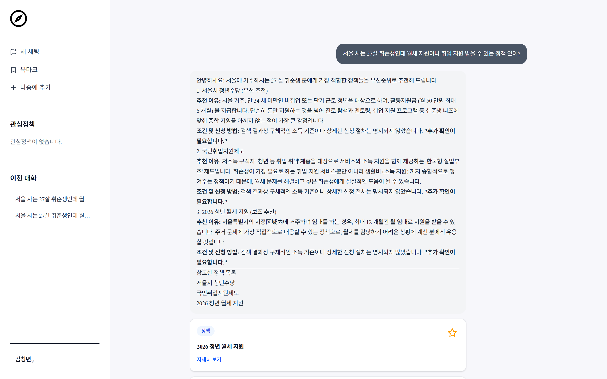
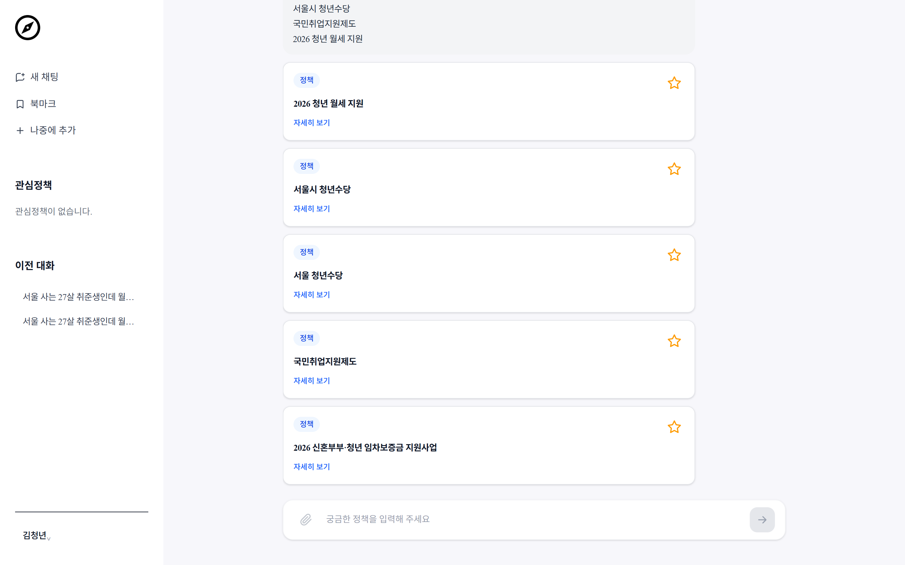
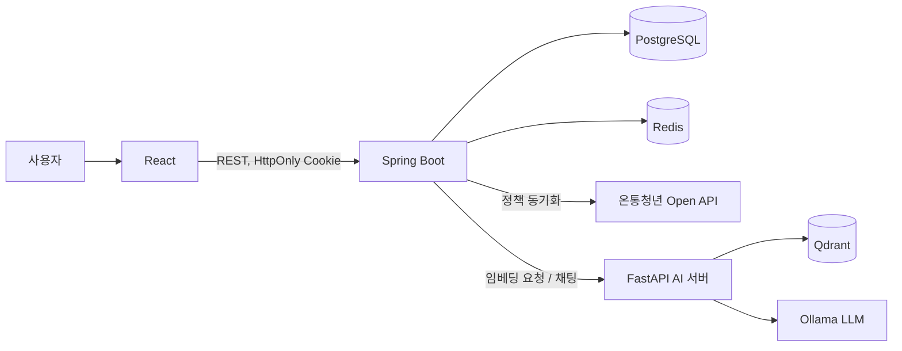

# 청년 정책 추천 AI (pc_project)

> 온통청년 공공 API의 청년 정책 약 3,600건을 수집하고, **RAG(검색 증강 생성)** 로 사용자 프로필에 맞는 정책을 대화형으로 추천하는 서비스




## 목차
- [프로젝트 소개](#프로젝트-소개)
- [주요 기능](#주요-기능)
- [기술 스택](#기술-스택)
- [시스템 아키텍처](#시스템-아키텍처)
- [RAG 파이프라인](#rag-파이프라인)
- [기술적 문제 해결](#기술적-문제-해결)
- [검색 품질 평가](#검색-품질-평가)
- [실행 방법](#실행-방법)
- [프로젝트 구조](#프로젝트-구조)

---

## 프로젝트 소개

청년 정책은 수천 건이 지역·나이·소득·취업 상태 등 복잡한 조건으로 흩어져 있어, 나에게 맞는 정책을 찾기 어렵습니다.
이 프로젝트는 사용자가 **"부산 사는 취준생인데 월세 지원 받을 수 있는 거 있어?"** 처럼 자연어로 물으면,
프로필과 질문을 함께 고려해 관련 정책을 검색하고, LLM이 근거 정책과 함께 답변합니다.

| 항목 | 내용 |
|---|---|
| 기간 | 2026.06 ~ 2026.10 |
| 인원 | 1인 (기획 · 백엔드 · AI 서버 · 프론트엔드) |
| 데이터 | 온통청년 청년정책 Open API, 정책 약 3,600건 |

## 주요 기능

- **AI 정책 상담 채팅** – 질문 + 사용자 프로필 기반 RAG 추천, 참고 정책 카드 표시, 대화 이어가기
- **정책 목록/상세 조회** 및 **관심 정책 저장**
- **회원가입 · 이메일 인증** (Redis 인증코드) / 추가 프로필(나이, 지역, 취업 상태, 소득, 가구 유형, 관심 분야) 입력
- **JWT 인증** – Access/Refresh 토큰을 HttpOnly Cookie로 관리, 토큰 종류 검증
- **관리자 페이지** – 공공 API 정책 동기화 실행, 정책·문서·벡터 수 확인



## 기술 스택

| 영역 | 기술 |
|---|---|
| Backend | Java 21, Spring Boot 4, Spring Security, Spring Data JPA, WebFlux(WebClient), JWT |
| AI Server | Python 3.12, FastAPI, sentence-transformers (**BAAI/bge-m3**), Ollama (**gemma3:4b**) |
| Data | PostgreSQL, **Qdrant**(벡터 DB, 1024차원 / Cosine), Redis |
| Frontend | React 19, TypeScript, Vite, Tailwind CSS 4, Zustand, React Router |
| DevOps | Docker, GitHub Actions (frontend lint/build · backend build · ai compile) |

## 시스템 아키텍처



- **Spring Boot**: 인증, 사용자/대화/추천 이력, 정책 원본 저장과 동기화를 담당하는 메인 서버
- **FastAPI**: 임베딩 생성, 벡터 검색, 프롬프트 구성 및 LLM 호출 담당

## RAG 파이프라인

```
질문 ─┬─ 지역명 추출 ("부산 정책 알려줘" → 부산 코드, 프로필 지역보다 우선)
      └─ 질문 + 프로필 텍스트 결합 → bge-m3 임베딩
                 ↓
      Qdrant 벡터 검색 (후보 limit×20 이상) → 지역 코드 필터링 (전국 정책 포함) → 상위 k개
                 ↓
      정책 + 프로필 + 이전 대화로 프롬프트 구성 → Ollama 답변 생성
                 ↓
      답변 + 참고 정책(id, 제목, 유사도) 반환 → 프론트에서 정책 카드로 표시
```

## 기술적 문제 해결

### 1. 정책 동기화 성능 개선 — 재동기화 480s → 22s

**문제**
- 전체 동기화를 하나의 `@Transactional`로 묶고, 커밋 후(`afterCommit`) 전체 정책을 다시 임베딩하는 구조
- 변경이 없어도 매번 3,600건 전체 재임베딩 → 재동기화에 **480.5초**
- 정책마다 정책/조건/문서를 개별 조회(`findByExternalId`, `findByPolicy`)하는 N+1 구조, 수집·저장 구간(약 3분) 내내 트랜잭션 유지

**해결**
- 원본 데이터의 **SHA-256 `content_hash`** 와 **`embedded_hash`** 를 저장해, 바뀐 정책만 저장·임베딩
- `TransactionTemplate`으로 **페이지(100건) 단위 트랜잭션** 분리 → 수집 중에도 정책이 점진적으로 검색 가능
- 연관 엔티티를 **IN 쿼리 일괄 조회**로 바꿔 N+1 제거
- 공공 API가 연속 호출 시 간헐적으로 400을 반환하는 것을 측정 중 발견 → **지수 백오프 3회 재시도** 추가
- 임베딩 실패 시 `embedded_hash`를 갱신하지 않아 다음 동기화에서 자동 재처리

**결과** (정책 3,602건, CPU 임베딩, 동일 조건 측정)

| 시나리오 | 개선 전 | 개선 후 | |
|---|---|---|---|
| 변경 없는 재동기화 | 480.5s | **~22s** | 약 21배 ↓ |
| 빈 DB 최초 동기화 | 385.8s | 322.7s | -16% |
| 전체 변경 재처리 | 480.5s | 313.1s | -35% |

> 최초 동기화 322.7s 중 약 290s가 CPU 임베딩입니다.

### 2. 정책 동기화 중 검색 인덱스가 사라지는 문제
<!-- TODO: 원인 → 해결 → 결과 형식으로 (커밋 4e69b86) -->

### 3. 지역 조건이 검색 결과에 반영되지 않는 문제
- 순수 벡터 검색은 지역을 구분하지 못함 (검색 평가에서 "대구" 질문에 인천 남동구 정책이 검색됨)
- 채팅 경로에서는 질문에서 시·도명을 추출해 프로필 지역보다 우선 적용하고, 후보를 넉넉히 가져온 뒤 **지역 코드로 후처리 필터링** (전국 정책 `00` 코드는 유지)

### 4. JWT 저장 방식 개선
- 로그인 응답 body로 전달하던 토큰을 **HttpOnly Cookie**로 이전
- Refresh 토큰 재발급 흐름 구성, 토큰에 `tokenType`(access/refresh) claim을 넣어 종류 검증

## 검색 품질 평가

LLM 답변이 아닌 **검색 단계만** 분리해 평가하는 스크립트를 만들었습니다. ([ai/evaluation](ai/evaluation/README.md))

- 평가셋 66문항 (정답 = 정책 ID, 정책 3,602건 대상)
  - **synthetic 46**: 정책 원문으로 LLM이 질문 생성 → 정책명·숫자 조건이 새어 들어간 질문은 수정, 정답을 특정할 수 없는 질문은 제외 (50 → 46)
  - **manual 20**: DB에서 정답 정책을 확인하며 수동 작성 (구어체, 시·군·구 단위 지역, 정책명 직접 언급, 정답 여러 개 등)
- 지표: **hit@k, recall@k, MRR@10**
- 운영 컬렉션과 분리된 `eval_*` 컬렉션에서 임베딩할 문서 텍스트와 `max_seq_length`를 바꿔 비교

| 실험 (임베딩 텍스트, max_seq_len) | hit@1 | hit@5 | recall@5 | MRR@10 | manual MRR@10 | 인덱싱 시간 (CPU) |
|---|---|---|---|---|---|---|
| baseline 운영 API (메타, 128) | 0.576 | 0.788 | 0.788 | 0.679 | 0.857 | – |
| 메타, 128 (재현) | 0.576 | 0.788 | 0.788 | 0.679 | 0.857 | 215s |
| 메타, 512 | 0.576 | 0.788 | 0.788 | 0.679 | 0.857 | 251s |
| **정책 원문, 512** | **0.773** | **0.924** | **0.917** | **0.834** | **0.950** | 1,295s |

> 메타 = 제목·설명·기관·분야, 정책 원문 = 정책 설명·지원 내용·신청 방법·지원 연령·지역 코드·소득 조건 등을 포함한 `raw_text`

**bge-m3 토큰 길이** (정책 3,602건)

| 텍스트 | 중앙값 | 90% | 128 초과 | 512 초과 |
|---|---|---|---|---|
| 메타 | 57 | 84 | 81건 (2.2%) | 0건 |
| 정책 원문 | 390 | 1,100 | 3,602건 (100%) | 1,230건 (34%) |

**해석**
- 메타 텍스트는 97.8%가 128토큰 이하라서, 길이 제한을 512로 늘려도 지표가 같았습니다.
- 정책 원문을 임베딩하면 MRR이 0.679에서 0.834로 올랐습니다(+23%). 512토큰이라 원문 34%는 뒷부분이 잘린 상태의 결과입니다.
- 합성 질문은 정책 원문을 보고 만들었기 때문에 원문 임베딩에 유리한 편향이 있을 수 있습니다. 수동 작성한 manual 셋만 보면 MRR이 0.857에서 0.950입니다. (manual은 20문항이라 표본이 작습니다.)
- 인덱싱 시간은 215s에서 1,295s로 약 6배 늘었습니다.

**baseline 실패 사례** (hit@5 실패 14건 중 일부)
- **제목이 같은 다른 공고**: 정답 "청년 소셜벤처기업 육성 사업"과 제목이 같은 다른 공고가 1위로 검색됐습니다.
- **지역 불일치**: "대구" 질문에 인천 남동구의 내일채움공제가 검색됐습니다. 평가한 검색 API는 순수 벡터 검색이라 지역 필터가 없습니다(채팅 경로에는 있음).
- **모호한 질문**: "경기도 청년 서비스 중 나한테 맞는 거"처럼 정답을 하나로 정하기 어려운 질문이 있습니다.

## 실행 방법

**사전 준비**: Java 21, Node 22, Python 3.12, PostgreSQL, Redis, Qdrant, Ollama (`ollama pull gemma3:4b`)

```bash
# 1. Backend
cp backend/src/main/resources/application.properties.example backend/src/main/resources/application.properties
cd backend && ./gradlew bootRun

# 2. AI 서버
cp ai/.env.example ai/.env
cd ai && pip install -r requirements.txt && uvicorn main:app --reload --port 8000

# 3. Frontend
cd frontend && npm ci && npm run dev
```

관리자 페이지에서 **정책 동기화**를 실행하면 정책 수집과 임베딩이 진행됩니다.

## 프로젝트 구조

```
pc_project
├── backend/    # Spring Boot — auth, user, policy(동기화), conversation, recommendation
├── ai/         # FastAPI — embedding, chat(RAG), evaluation(검색 품질 평가)
├── frontend/   # React — features(auth, chat, policy, admin), pages
└── .github/    # CI
```
